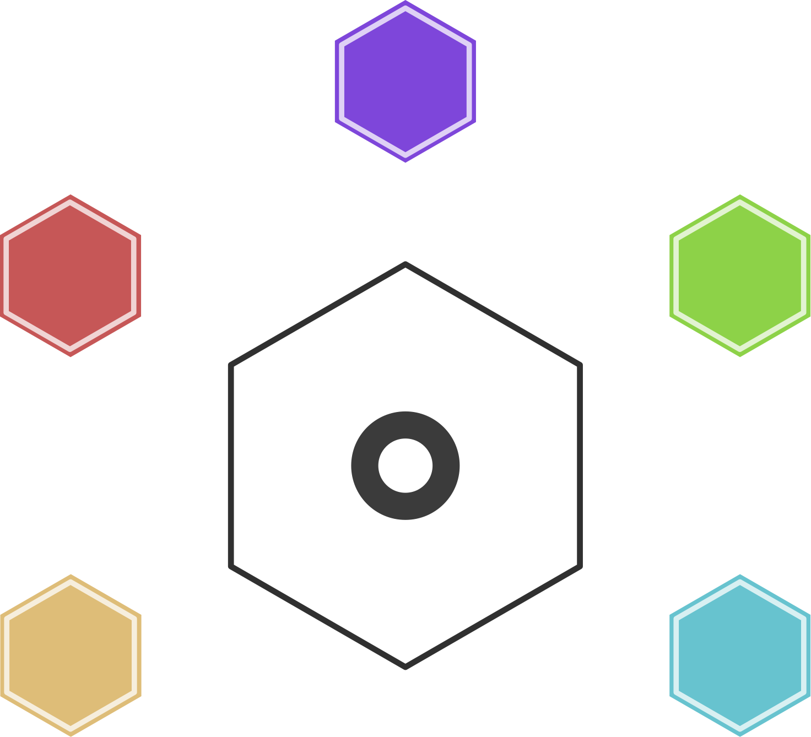

# GL HUB



**GL HUB** est une plateforme éducative gratuite, créée par un étudiant en Génie Logiciel pour ses camarades. Elle centralise les ressources pédagogiques du cursus et accueille aujourd'hui **deux classes** :

- **L1 Génie Logiciel** : les matières fondamentales (cours, TD, TP), avec une progression à son rythme grâce à des quiz ;
- **L2 Génie Logiciel** : un espace privé réservé aux membres de la classe, avec les ressources déposées par le responsable, l'emploi du temps mis à jour en direct et une discussion écrite et vocale.

[](https://glhub.vercel.app)
[](LICENSE)

**Version actuelle : 3.9.0** (voir le [journal des versions](CHANGELOG.md)). Pour comprendre comment le projet est né, les difficultés rencontrées et comment créer un projet du même genre, lis la [documentation du projet](DOCUMENTATION.md).

---

## Table des matières

- [À propos](#à-propos)
- [Les deux classes](#les-deux-classes)
- [Fonctionnalités](#fonctionnalités)
- [L1 : comment fonctionne le déblocage par quiz](#l1--comment-fonctionne-le-déblocage-par-quiz)
- [L1 : matières couvertes](#l1--matières-couvertes)
- [L2 : l'espace de la classe](#l2--lespace-de-la-classe)
- [Architecture technique](#architecture-technique)
- [Structure du projet](#structure-du-projet)
- [Installer ou reprendre le projet](#installer-ou-reprendre-le-projet)
- [Activer la connexion avec Google](#activer-la-connexion-avec-google)
- [Gérer les quiz (administrateurs)](#gérer-les-quiz-administrateurs)
- [Gérer l'espace L2 (administrateur et responsable)](#gérer-lespace-l2-administrateur-et-responsable)
- [Vérifier la barre de navigation](#vérifier-la-barre-de-navigation)
- [Documentation et journal des versions](#documentation-et-journal-des-versions)
- [Contribution](#contribution)
- [Remerciements](#remerciements)
- [Auteur](#auteur)
- [Licence](#licence)

---

## À propos

Face à la dispersion des supports de cours et au manque de centralisation des ressources pédagogiques, GL HUB réunit au même endroit tout ce dont une classe de Génie Logiciel a besoin au quotidien : les cours, les TD, les examens, l'emploi du temps et un espace pour échanger.

**Objectifs**
- Faciliter l'accès aux cours magistraux, TD, examens et projets académiques
- Favoriser l'autonomie et la progression des étudiants
- Remplacer les ressources perdues dans les messages d'un groupe de discussion par un espace organisé
- Devenir une référence durable pour la communauté étudiante
- Encourager le partage, la collaboration et l'excellence

---

## Les deux classes

Depuis la barre de navigation, le menu **Classes** propose :

| Classe | Pour qui | Accès |
|---|---|---|
| **L1 Génie Logiciel** | Les cinq matières fondamentales du cursus | Catalogue visible par tous ; lecture et téléchargement avec un compte |
| **L2 Génie Logiciel** | La classe 2026/2027 | Espace privé : accès sur demande, validé par l'administrateur |

La page d'accueil présente les deux classes, et le menu **Classes** dirige chacun au bon endroit : la connexion s'il n'est pas connecté, l'espace de la classe s'il en fait partie, la demande d'accès sinon.

---

## Fonctionnalités

**Communes aux deux classes**
- **100 % gratuit** : pas de paiement, pas d'abonnement
- **Connexion avec Google** en un clic, ou avec une adresse institutionnelle classique, avec liaison possible entre les deux comptes
- **Thème clair et sombre**, interface responsive (téléphone, tablette, ordinateur)
- **Espace administrateur** pour gérer les étudiants, les quiz et la classe L2

**L1 Génie Logiciel**
- **5 matières**, 57 ressources pédagogiques (cours, TD, TP, projet d'examen)
- **Déblocage progressif des cours** : le premier cours de chaque matière est libre, les suivants se débloquent avec un quiz (70 % minimum). Les **TD sont libres pour tout le monde**
- **Quiz aléatoires** : deux étudiants n'ont pas forcément les mêmes questions
- **Lecture en ligne ou téléchargement** de chaque ressource (utilisateurs connectés)
- **Historique personnel** des dernières ressources lues et téléchargées
- **Catalogue ouvert à tous** : tout visiteur voit les matières et peut utiliser la recherche

**L2 Génie Logiciel**
- **Accès réservé à la classe**, validé par l'administrateur après vérification du numéro WhatsApp
- **Ressources** déposées par le responsable de classe, vérifiées puis publiées, classées par matière et par catégorie (cours, TD, examens, liens, autres), avec recherche
- **Vidéos YouTube** : miniature affichée et lecteur intégré au site
- **Emploi du temps** par semaine, modifiable uniquement par l'administrateur et le responsable, avec les changements (« Modifié », « Annulé ») visibles en direct
- **Discussion** de la classe : messages écrits et vocaux (2 minutes maximum), supprimés automatiquement après 7 jours

---

## L1 : comment fonctionne le déblocage par quiz

1. **Crée un compte** (gratuit) et connecte-toi.
2. **Les TD, TP et projets sont libres** : tu peux les lire ou les télécharger tout de suite.
3. **Le premier cours** de chaque matière est libre aussi.
4. Pour débloquer le **cours suivant**, passe le **quiz du cours que tu viens de lire** : 10 questions tirées au hasard dans une banque de questions.
5. Il faut **70 % minimum**. En cas d'échec, tu peux réessayer après 2 minutes, avec des questions qui peuvent être différentes.
6. Après une réussite, tu vois la **correction** avec les explications, et le cours suivant est débloqué.
7. Les cours suivent un **ordre pédagogique** (Chapitre 1 avant Chapitre 2...). Chaque carte indique son numéro (« Cours 3 sur 8 ») ou « Accès libre » pour un TD.

Les administrateurs ont accès à toutes les ressources, sans quiz ni délai d'attente. Les étudiants qui avaient déjà payé l'ancien système (500 FCFA par ressource) ont gardé l'accès à leurs ressources.

---

## L1 : matières couvertes

| Matière | Description | Lien |
|---|---|---|
| **Algorithmique** | Notions préliminaires, structures conditionnelles et itératives, types composés, chaînes, tableaux, programmation modulaire | [Accéder →](algo.html) |
| **Langage C** | Généralités, structures conditionnelles et itératives, types composés, chaînes, tableaux, programmation modulaire | [Accéder →](langageC.html) |
| **Base de Données** | Merise et MCD, modèle entité-association, SGBD, introduction au SQL | [Accéder →](basedeDonnees.html) |
| **Systèmes d'Exploitation** | Windows : dossiers et fichiers, utilisateurs locaux, restauration et tâches planifiées, batch, variables d'environnement | [Accéder →](systemedExploitation.html) |
| **Technologies Web** | HTML (listes, médias, liens, formulaires), CSS, JavaScript (DOM, Web Storage) | [Accéder →](technologieWeb.html) |

---

## L2 : l'espace de la classe

### Comment y entrer

1. **Crée un compte** (ou connecte-toi).
2. Menu **Classes** → **L2 Génie Logiciel** → **Demander l'accès**.
3. Saisis le **numéro WhatsApp** que tu utilises dans le groupe de la classe. L'administrateur le compare avec le groupe pour vérifier que tu fais bien partie de la classe, puis accepte la demande. Le numéro n'est visible que par l'administrateur.
4. Une fois accepté, tu accèdes à l'espace, qui contient trois onglets : **Ressources**, **Emploi du temps** et **Discussion**.

L'administrateur entre directement, sans formulaire ni numéro.

### Les trois rôles

| Rôle | Peut faire |
|---|---|
| **Étudiant** | Consulter les ressources publiées, voir l'emploi du temps, participer à la discussion, supprimer ses propres messages |
| **Responsable de classe** | Tout ce que fait l'étudiant, plus : déposer des ressources, modifier l'emploi du temps, supprimer n'importe quel message de la discussion |
| **Administrateur** | Tout ce que fait le responsable, plus : valider les demandes d'accès, publier ou refuser les dépôts, gérer les matières et les membres, nommer le responsable |

### Les trois onglets

**Ressources**
- Classées par matière et par catégorie (cours, TD, examens, liens, autres), avec une recherche qui ignore les accents.
- Les PDF, images et fichiers texte s'ouvrent dans le navigateur (bouton **Lire**) ; les autres formats se téléchargent.
- Les liens YouTube affichent leur miniature, et la vidéo se lit dans une fenêtre sur le site.
- Les nouveautés portent la mention « Nouveau » pendant 7 jours.

**Emploi du temps**
- Vue par semaine, du lundi au samedi (le dimanche s'il y a une séance), avec la journée du jour en évidence et le prochain cours.
- Le responsable et l'administrateur ajoutent, modifient, annulent ou rétablissent une séance, ou copient la semaine précédente. Un changement d'horaire, de salle ou d'enseignant marque automatiquement la séance **Modifié**, une annulation la marque **Annulé**, avec une note facultative pour la classe.
- Les changements apparaissent en direct chez tous les membres.

**Discussion**
- Messages écrits (1000 caractères maximum) et vocaux (2 minutes maximum), en temps réel.
- **Fenêtre glissante de 7 jours** : un message de plus de 7 jours n'est plus visible, et un nettoyage nocturne supprime réellement les messages et les fichiers audio.
- Les vocaux sont enregistrés en MP4 (AAC) quand le navigateur le permet, pour rester lisibles sur les appareils plus anciens.
- Anti-spam : 20 messages par minute au maximum.

---

## Architecture technique

- **Front-end** : HTML, CSS et JavaScript (sans framework), hébergé sur **Vercel** ([glhub.vercel.app](https://glhub.vercel.app)). Icônes : Font Awesome.
- **Back-end** : [Supabase](https://supabase.com) (authentification, base PostgreSQL avec RLS, stockage privé, Edge Functions, temps réel).

**Tables principales : L1**

| Table | Rôle |
|---|---|
| `matieres` | Les 5 matières de la L1 |
| `ressources` | Les fichiers pédagogiques, avec leur `type` (cours / td / ...) et leur `ordre` dans la matière |
| `questions_quiz` | La banque de questions (lisible uniquement par les administrateurs) |
| `tentatives_quiz` | Chaque passage de quiz : questions tirées, score, réussite |
| `deblocages` | Les cours débloqués par chaque étudiant |
| `evenements_ressources` | L'historique des lectures et téléchargements |
| `profils`, `admins` | Profils des étudiants et comptes administrateurs |
| `paiements`, `liens_temporaires` | Ancien système de paiement, conservé mais plus utilisé |

**Tables principales : L2**

| Table | Rôle |
|---|---|
| `classes` | Les classes (ici la L2 2026/2027) |
| `membres_classe` | Les membres de chaque classe et leur rôle (`etudiant` ou `responsable`) |
| `demandes_acces` | Les demandes d'accès, avec le numéro WhatsApp normalisé (unique par classe) |
| `matieres_classe` | Les matières propres à chaque classe |
| `depots` | Les ressources déposées (fichier ou lien), leur état (`en_attente`, `publie`, `refuse`) et l'identifiant YouTube extrait automatiquement |
| `seances_l2` | Les séances de l'emploi du temps (une ligne par séance datée) |
| `messages_l2` | Les messages de la discussion (écrits et vocaux) |

**Stockage (buckets privés)** : `ressources-privees` (L1), `ressources-l2` (ressources de la L2), `chat-l2` (messages vocaux).

**Edge Functions**

| Fonction | Rôle |
|---|---|
| `quiz-start` | Vérifie l'accès, tire 10 questions au hasard parmi les questions actives du cours et les envoie **sans les bonnes réponses** |
| `quiz-submit` | Corrige côté serveur, enregistre le score et débloque le cours suivant en cas de réussite (≥ 70 %) |
| `resource-access` | Vérifie l'accès (TD libres, cours débloqués, admin) puis renvoie le **fichier lui-même** : aucun lien partageable n'est donné au navigateur |
| `l2-resource-access` | Même principe pour la L2 : l'accès est décidé par les règles RLS de la table `depots` |
| `l2-chat-purge` | Nettoyage nocturne de la discussion (messages de plus de 7 jours et leurs fichiers audio), déclenché par `pg_cron` et protégé par un secret |

**Sécurité**
- Les fichiers sont dans des buckets Storage privés, livrés uniquement par les Edge Functions, qui revérifient l'accès à chaque lecture ou téléchargement : le navigateur ne reçoit jamais de lien réutilisable ni partageable.
- Les quiz sont tirés au hasard et corrigés côté serveur ; la table `questions_quiz` est protégée par RLS et invisible pour les étudiants.
- La recherche publique passe par la vue `catalogue_public` (en `security_invoker`), qui n'expose que le titre, le type et la matière.
- La connexion Google utilise la liaison manuelle d'identité (`linkIdentity`) pour éviter les comptes en double.
- **Dans l'espace L2, l'accès est contrôlé en base de données (RLS et triggers), pas seulement dans l'interface** : un étudiant ne peut ni s'accepter lui-même, ni publier un dépôt, ni lire les données d'une classe dont il n'est pas membre, même en appelant Supabase directement. Le nom et l'auteur d'un message ou d'une demande sont imposés par le serveur.
- Tous les textes saisis par les utilisateurs sont affichés avec `textContent` (jamais `innerHTML`), et le type d'un fichier est décidé par son extension : un fichier `.html` déposé par erreur ne peut pas s'exécuter sur le site.
- Voir aussi [SECURITY.md](SECURITY.md).

---

## Structure du projet

```text
GL-HUB/
├── index.html, contact.html, profil.html
├── algo.html, langageC.html, basedeDonnees.html
├── systemedExploitation.html, technologieWeb.html      # L1
├── acces-l2.html, espace-l2.html, emploi-du-temps-l2.html
├── discussion-l2.html, responsable-l2.html              # L2
├── admin.html, admin-quiz.html, admin-l2.html           # espace administrateur
├── supabaseClient.js                    # configuration Supabase (clé publique "anon")
├── auth.js                              # connexion, inscription, Google, recherche
├── acces.js                             # lecture, téléchargement, quiz, déblocage (L1)
├── classes-nav.js                       # menu Classes
├── niveau.js                            # choix de la classe sur l'accueil
├── l2-outils.js                         # outils communs de la L2 (YouTube, fichiers, ouverture sécurisée)
├── acces-l2.js, espace-l2.js, emploi-du-temps-l2.js
├── discussion-l2.js, responsable-l2.js, admin-l2.js
├── profil.js, admin.js, admin-quiz.js, theme.js
├── verifier-nav.py                      # vérifie que la barre de navigation est identique partout
├── STYLES/                              # une feuille par page + theme.css, auth.css, acces.css, classes-nav.css...
├── MEDIAS/
├── supabase/
│   ├── migrations/                      # scripts SQL, à lancer dans l'ordre
│   ├── planification_purge_chat_l2.sql  # guide de mise en place du nettoyage nocturne
│   └── functions/                       # Edge Functions (fichiers autonomes)
│       ├── quiz-start/index.ts
│       ├── quiz-submit/index.ts
│       ├── resource-access/index.ts
│       ├── l2-resource-access/index.ts
│       └── l2-chat-purge/index.ts
├── README.md, DOCUMENTATION.md, CHANGELOG.md
├── LICENSE
└── SECURITY.md
```

---

## Installer ou reprendre le projet

1. Crée un projet Supabase et renseigne son URL et sa clé **anon** dans `supabaseClient.js`. N'utilise **jamais** la clé `service_role` dans le navigateur.
2. Crée les tables `matieres`, `ressources`, `paiements`, `admins` et `profils`, puis ajoute tes matières et tes ressources (avec une colonne `type` : `cours`, `td`, etc.).
3. Dans le **SQL Editor**, lance les scripts de `supabase/migrations/` dans l'ordre :

   | Script | Rôle |
   |---|---|
   | `001_quiz_unlock.sql` | Tables du quiz, règle d'accès, règles RLS |
   | `002_reorganiser_ordre.sql` | Ordre pédagogique des ressources *(spécifique aux titres actuels, à adapter si tu changes les ressources)* |
   | `003_droits_lecture.sql` | Droits de lecture des nouvelles tables |
   | `004_recherche_publique_et_admin_quiz.sql` | Recherche ouverte aux visiteurs, gestion des questions par les admins |
   | `005_vue_catalogue_securisee.sql` | Sécurise la vue de recherche (droits par colonne) |
   | `006_quiz_seulement_pour_les_cours.sql` | Les quiz ne concernent que les cours ; les TD sont libres |
   | `007_corriger_chemins_fichiers.sql` | Corrige des chemins de fichiers *(spécifique aux données de ce projet ; contient deux requêtes de contrôle à lancer même si tu n'as pas ce problème)* |
   | `20261013_espace_l2.sql` | **Espace L2** : classes, membres, demandes d'accès, matières, dépôts, règles RLS, bucket `ressources-l2`. Relançable : il met aussi à niveau une base créée avec une version précédente du script |
   | `20261014_chat_l2.sql` | **Discussion L2** : messages, règles RLS, bucket `chat-l2`, temps réel. Relançable |
   | `20261015_emploi_du_temps_l2.sql` | **Emploi du temps L2** : table `seances_l2`, règles RLS, temps réel. Relançable |

4. Crée un **bucket privé** dans Storage et envoie-y tes fichiers de L1. Le chemin de chaque fichier doit correspondre à la colonne `chemin_fichier` de `ressources`. Le nom attendu est `ressources-privees` (constante en haut de `supabase/functions/resource-access/index.ts`) ; s'il est différent, la fonction cherche automatiquement le fichier dans les autres buckets. Les buckets `ressources-l2` et `chat-l2` sont créés par les scripts de la L2.
5. Déploie les fonctions de `supabase/functions/` (`supabase functions deploy quiz-start`, etc., ou en collant le code dans le tableau de bord Supabase : chaque fichier est autonome). Désactive **Verify JWT** sur `quiz-start`, `quiz-submit`, `resource-access` et `l2-resource-access` : chaque fonction vérifie elle-même l'identité de l'utilisateur. `l2-chat-purge` se déploie avec `--no-verify-jwt` et exige un secret (voir l'étape suivante).
6. **Planifie le nettoyage de la discussion** en suivant, étape par étape, `supabase/planification_purge_chat_l2.sql` : choisir un secret (`CRON_SECRET`), activer les extensions `pg_cron` et `pg_net` (*Database → Extensions*), enregistrer le secret dans le coffre (Vault), puis programmer le job de 03:00. Sans ce nettoyage, personne ne voit un message de plus de 7 jours, mais les données restent stockées.
7. Ajoute ton compte dans la table `admins` (`user_id` de ton compte) pour accéder à l'espace administrateur.
8. Dans **Admin → Espace L2**, crée les matières de la classe, puis nomme le responsable (il doit d'abord avoir créé son compte et demandé l'accès).
9. Facultatif : [active la connexion avec Google](#activer-la-connexion-avec-google).

---

## Activer la connexion avec Google

Le bouton « Continuer avec Google » est déjà dans le site. Pour qu'il fonctionne, il faut le configurer une fois :

1. **Google Cloud Console** → *APIs & Services* → *Credentials* → *Create credentials* → *OAuth client ID* (type **Web application**).
   - *Authorized JavaScript origins* : l'adresse de ton site, par exemple `https://glhub.vercel.app` (et `http://127.0.0.1:5500` pour tester en local).
   - *Authorized redirect URIs* : `https://<ton-projet>.supabase.co/auth/v1/callback`.
   - Dans *OAuth consent screen*, renseigne le nom « GL HUB » et passe l'application en **production** (sinon seuls les comptes de test peuvent se connecter).
2. **Supabase** → *Authentication* → *Sign In / Providers* → **Google** : active-le et colle le *Client ID* et le *Client Secret*.
3. **Supabase** → *Authentication* → *Sign In / Providers* → active **Allow manual linking of accounts** (nécessaire pour l'étape de liaison ci-dessous).
4. **Supabase** → *Authentication* → *URL Configuration* :
   - *Site URL* : l'adresse de ton site, par exemple `https://glhub.vercel.app/`
   - *Redirect URLs* : `https://glhub.vercel.app/**` et `http://127.0.0.1:5500/**`

**Un nouvel étudiant** qui clique sur « Continuer avec Google » obtient un compte créé automatiquement, sans adresse `@gl.com` ni mot de passe GL HUB.

**Un étudiant qui a déjà un compte `@gl.com`** doit d'abord **lier** son compte Google au sien (sinon un second compte, vide, serait créé par erreur) :
1. se connecter normalement avec son adresse `@gl.com` et son mot de passe ;
2. sur sa page **Profil**, cliquer sur **Lier mon compte Google** ;
3. ensuite, le bouton Google du site le connecte directement à ce même compte, avec sa progression.

Un compte Google déjà lié à quelqu'un d'autre ne peut pas être relié une seconde fois : le site l'indique clairement plutôt que de planter.

---

## Gérer les quiz (administrateurs)

Depuis l'espace **Admin → Quiz** (`admin-quiz.html`) :

- choisis une matière, puis un cours : un badge indique combien de questions il possède (**20 questions ou plus** sont conseillées pour varier les quiz, 10 au minimum) ;
- ajoute une question avec le formulaire (2 à 6 propositions, une bonne réponse, une explication facultative), modifie-la, désactive-la ou supprime-la ;
- ou **importe plusieurs questions d'un coup** en collant du JSON :

```json
[
  {
    "question": "Quelle boucle s'exécute au moins une fois ?",
    "options": ["Pour", "Tant que", "Répéter ... jusqu'à", "Aucune"],
    "bonne_reponse": "Répéter ... jusqu'à",
    "explication": "Le test est fait après le premier passage."
  }
]
```

Seuls les **cours** ont un quiz : les TD n'apparaissent qu'avec la mention « Accès libre ». Le dernier cours de chaque matière n'a pas besoin de quiz, puisqu'il ne débloque rien. Un cours sans question bloque le cours suivant : remplis la banque avant d'ouvrir une nouvelle matière au public.

---

## Gérer l'espace L2 (administrateur et responsable)

### Administrateur : page Admin → Espace L2 (`admin-l2.html`)

- **Dépôts à valider** : ouvre chaque fichier ou lien avant de le publier. Une fois publié, toute la classe le voit. Tu peux refuser avec un motif, que le responsable verra.
- **Demandes en attente** : compare le numéro WhatsApp affiché (boutons *Copier* et *Ouvrir dans WhatsApp*) avec celui du groupe de la classe, puis **Accepter** ou **Refuser** (avec un motif facultatif). Vérifie aussi que le nom correspond.
- **Matières de la L2** : ajoute une matière en tapant son nom ; une matière ne peut être supprimée que si aucune ressource ne l'utilise.
- **Membres** : nomme un responsable, retire-lui ce rôle, ou retire un membre (il perd l'accès et doit refaire une demande).
- **Ressources publiées** : supprime une ressource (son fichier est supprimé aussi).

### Responsable : page Espace responsable (`responsable-l2.html`)

- Dans l'onglet **Ressources**, le bouton **Déposer une ressource** ouvre le formulaire : matière, catégorie, titre, description, puis un fichier (PDF, Word, Excel, PowerPoint, images, archives, code ; 50 Mo maximum) ou, pour la catégorie *Lien*, une adresse (YouTube comprise).
- Un dépôt reste **en attente** jusqu'à sa validation par l'administrateur. La liste *Mes dépôts* indique l'état de chacun, et le responsable peut supprimer ceux qui ne sont pas encore publiés.
- Dans l'onglet **Emploi du temps**, le bouton **Modifier l'emploi du temps** permet d'ajouter (avec répétition hebdomadaire), de modifier, d'annuler, de rétablir ou de supprimer une séance, et de copier la semaine précédente.
- Dans **Discussion**, le responsable peut supprimer n'importe quel message (bouton *Supprimer* sous le message).

---

## Vérifier la barre de navigation

La barre de navigation est écrite dans chaque page : pour éviter qu'elle diffère d'une page à l'autre, lance depuis la racine du dépôt, avant un commit :

```bash
python3 verifier-nav.py
```

Le script compare la barre de chaque page publique à celle de `acces-l2.html` et le menu des trois pages d'administration. Il affiche les pages à corriger (code de sortie 1) ou « Toutes les barres de navigation sont identiques ». Il ne modifie aucun fichier.

---

## Documentation et journal des versions

- [**DOCUMENTATION.md**](DOCUMENTATION.md) : comment le projet est né, les étapes suivies, les difficultés rencontrées et un guide pour créer un projet du même genre.
- [**CHANGELOG.md**](CHANGELOG.md) : toutes les évolutions, version par version.
- [**SECURITY.md**](SECURITY.md) : versions maintenues et signalement d'une vulnérabilité.

---

## Contribution

Les contributions sont les bienvenues, notamment pour :

- ajouter ou améliorer des ressources pédagogiques
- corriger un bug ou améliorer l'interface
- proposer une nouvelle fonctionnalité

Étapes :

1. **Forker** le projet
2. **Créer une branche** (`git checkout -b feature/amelioration`)
3. **Commit** tes changements (`git commit -m "feat: ..."`)
4. **Pousser** la branche (`git push origin feature/amelioration`)
5. **Ouvrir une Pull Request**

Avant de proposer un changement qui touche la barre de navigation, lance `python3 verifier-nav.py`.

---

## Remerciements

Un grand merci à mes camarades **Mouhamed Diop** et **Mory Ndour**, qui m'ont fait découvrir **Supabase**. Grâce à eux, j'ai pu gérer la base de données, l'authentification et la partie serveur de cette plateforme. Le récit complet est dans la [documentation du projet](DOCUMENTATION.md#remerciements).

Merci aussi à mes camarades de classe, qui ont découvert GL HUB lors de l'examen pratique du premier semestre et qui l'utilisent aujourd'hui.

---

## Auteur

**Mohamed BATHILY** – Étudiant en Génie Logiciel

- GitHub : [@mhdev-x](https://github.com/mhdev-x)
- Projet : [GL HUB](https://github.com/mhdev-x/GL-HUB)

---

## Licence

Ce projet est sous licence **MIT** — voir le fichier [LICENSE](LICENSE) pour plus de détails.